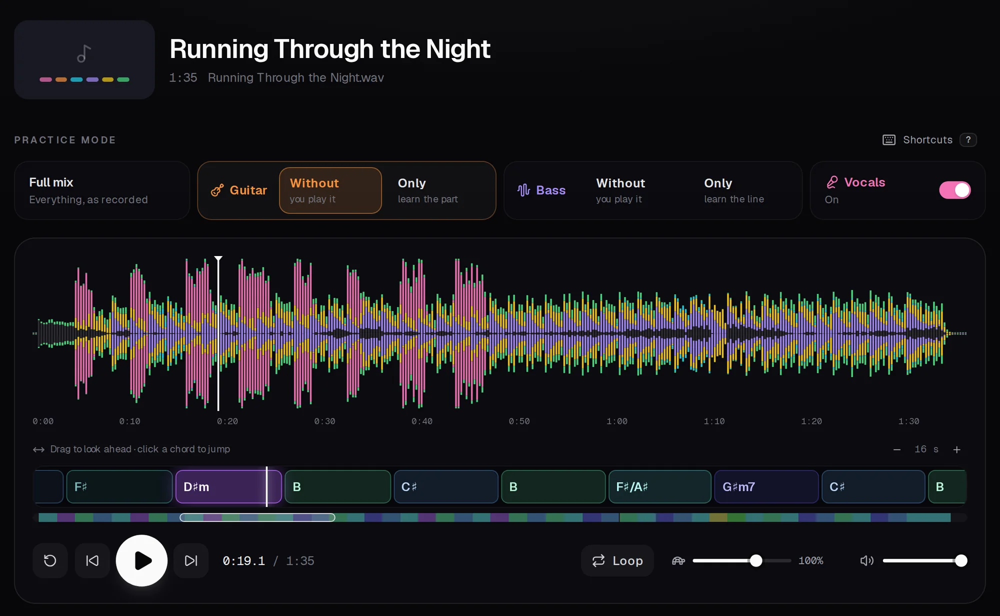
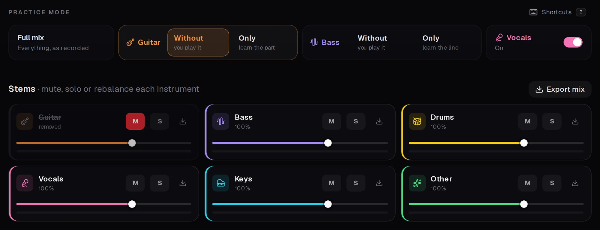
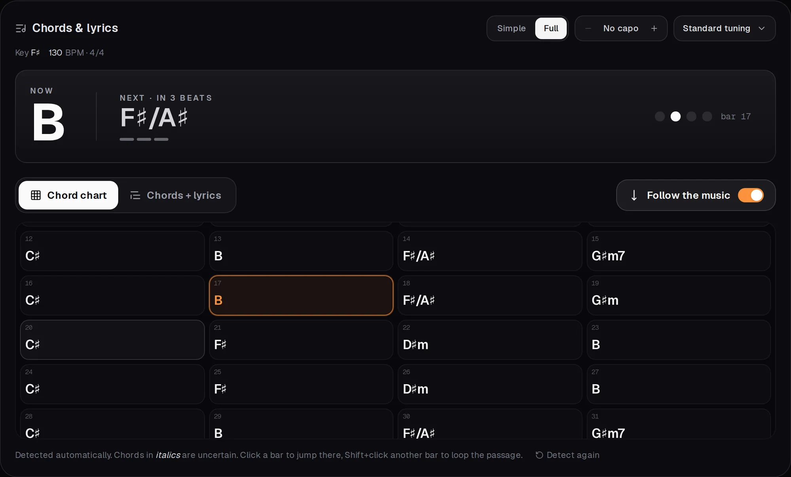
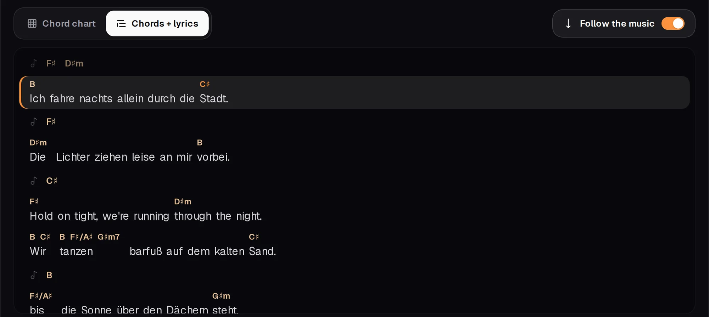
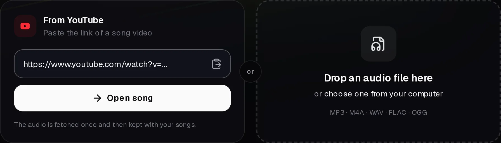
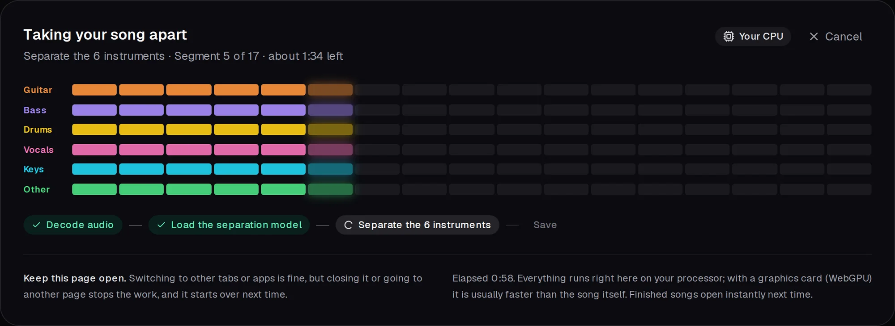

<div align="center">


# PlayAlong

**Be the missing part of any song.**

Paste a YouTube link or drop in a song. PlayAlong takes it apart into guitar, bass, drums, vocals and keys,<br />
and writes out the chords for guitar and bass and the lyrics. All done by AI, free, on your own computer.

[Get started](#get-started) · [Features](#features) · [How it works](#how-it-works) · [Technical notes](docs/TECHNICAL.md)

<br />



</div>

<br />

## Features

### Switch the guitar or bass off and take its place

The AI splits every song into **six instruments**: guitar, bass, drums, vocals, keys and the rest. One click mutes your
instrument so you can play it yourself, or plays it **alone** so you can learn the part. Every instrument has its own
fader, and the vocals switch on and off on top of any mode.



### The chords for guitar and bass, worked out for you

PlayAlong listens to the song and writes out the **chords bar by bar**, with key and tempo: big for what to play now and
next with a beat counter, as a chart of the whole song, and on a timeline under the waveform. Set a **capo** or a
**half step down** tuning and the shapes change with it. Simple chords to start, full chords (7ths, sus, slash chords)
when you want them.



### The lyrics, with every chord on its word

Whisper, the speech AI, writes down what's sung, in English, German and about 100 other languages (even mixed in one
song). Each chord sits right above the word where it changes, and the sheet **scrolls with the music** like a
teleprompter. Click a line to jump there, Shift + click to loop it.



### Bring any song

Paste the link of a **YouTube** video, or **drag and drop** an audio file (MP3, M4A, WAV, FLAC, OGG). Your songs are
kept, so they open instantly next time. In Chrome and Edge they can also live in a folder of your choice, as one
`.playalong` file each: put it in OneDrive, Dropbox or iCloud Drive and your songs are on all your computers.



### Free, private, on your own computer

No upload, no account, no subscription. The AI runs **inside your browser**, on your graphics card through WebGPU
(or on the processor without one). A song takes a few minutes the first time and opens instantly after that.



### And for practising

- **Slow down** to 50 % without the pitch changing
- **Loop** any passage: drag over the waveform, or Shift + click bars or lyric lines
- **Download** the backing track or any single instrument as WAV
- **Keyboard shortcuts** for everything (press `?` in the player)

## Get started

PlayAlong runs on your own computer, on **Windows, macOS and Linux**, with the same three steps.

**1. Install [Node.js](https://nodejs.org) 22 or newer** (the LTS version) and [git](https://git-scm.com/downloads).
Nothing else: no Python, no account.

**2. Open a terminal and run:**

```bash
git clone https://github.com/simonroedig/PlayAlong.git
cd PlayAlong
npm install
npm run dev
```

> No git? [Download the ZIP](https://github.com/simonroedig/PlayAlong/archive/refs/heads/main.zip), unpack it, open a
> terminal in the folder and run `npm install` and `npm run dev`.

**3. Open [localhost:3000](http://localhost:3000)** in Chrome or Edge.

The first start downloads the AI models and the YouTube helper by itself (about 700 MB, once). After that it starts
right away. To stop it press `Ctrl + C`; next time just run `npm run dev` in the PlayAlong folder again.

<details>
<summary><b>Keyboard shortcuts</b></summary>

| Key | Action |
| --- | --- |
| `Space` | Play / pause |
| `←` / `→` | Skip 5 s (`Shift`: 1 s) |
| `Home` | Back to start (or loop start) |
| `1` to `5` | Full mix · No guitar · Guitar only · No bass · Bass only |
| `V` | Vocals on / off |
| `G` / `B` | Mute / unmute guitar / bass |
| `L` | Loop on / off (creates an 8 s loop at the playhead if none) |
| `[` / `]` | Set loop start / end at the playhead |
| `-` / `+` | Slower / faster (50 to 125 %) |
| `?` | Show all shortcuts |

</details>

<details>
<summary><b>Good to know</b></summary>

- **Graphics card:** with one (Chrome or Edge, WebGPU) a song is usually taken apart faster than it plays. Without one
  it runs on the processor and takes about one to two times the song's length.
- **Accuracy:** the instruments, chords and lyrics come from AI models and are a very good starting point, not a
  verified transcription. Dense, distorted guitars can leave some bleed; unsure chords are shown in italics and unsure
  words are underlined.
- **Long recordings:** up to 30 minutes. A live set or medley is split into its songs, each with its own key and
  tempo. Lyrics need about 3 GB of free memory.
- **Open it via `localhost`:** browsers turn off the audio and AI features on plain-HTTP network addresses.
- **Your music:** use songs you have the right to use.

</details>

## How it works

Three open AI models, running in your browser with [ONNX Runtime Web](https://onnxruntime.ai):

| Job | Model |
| --- | --- |
| Take the song apart into six instruments | [Demucs v4](https://github.com/facebookresearch/demucs) `htdemucs_6s` by Meta |
| Find the chords | [BTC](https://github.com/jayg996/BTC-ISMIR19) (Bi-directional Transformer for Chord recognition) |
| Write down the lyrics | [Whisper](https://github.com/openai/whisper) large-v3 turbo by OpenAI |

The audio processing around them (spectrograms, Whisper's decoding and word timing) is ported to TypeScript and checked
against the original Python implementations. The Next.js server only fetches the audio of YouTube links (with
[yt-dlp](https://github.com/yt-dlp/yt-dlp)); everything else happens in the browser.

More in the **[technical notes](docs/TECHNICAL.md)**: architecture, model research, configuration, development and
verification.

## Development

```bash
npm run lint
npm run typecheck
npm test
```

## Credits

Made by [Simon Roedig](https://simonroedig.com).

Demucs (MIT, weights by Meta for research use), BTC (MIT, see `public/models/BTC-LICENSE.txt`), Whisper (MIT) and its
int8 export by [sherpa-onnx](https://github.com/k2-fsa/sherpa-onnx) (Apache-2.0).
